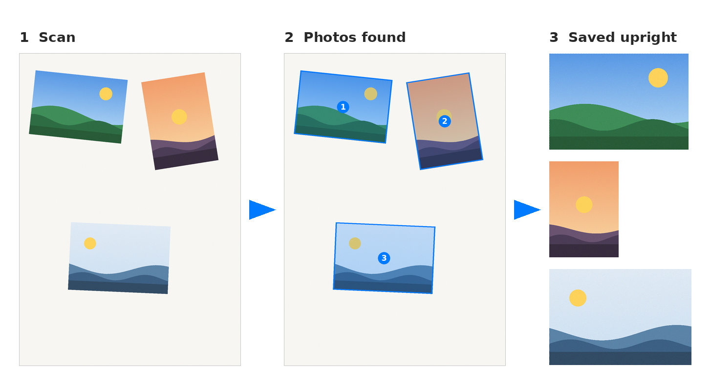

<p align="center">
  
</p>

<h1 align="center">ScanCrop</h1>

<p align="center">
  <b>Cut photos out of flatbed scans automatically, on your Mac.</b><br>
  Drop in hundreds of scans. ScanCrop finds every photo, straightens it and cuts away the white scanner background.
</p>

<p align="center">
  <a href="https://github.com/zulu101/ScanCrop/releases/latest"></a>
  
  
  
  <a href="LICENSE"></a>
  <a href="https://github.com/zulu101/ScanCrop/actions/workflows/build.yml"></a>
</p>

---

Digitising a box of old prints on an A4 scanner leaves you with hundreds of scans, each with one or more photos somewhere on a big white page, usually a little tilted. Cropping them one by one takes hours. ScanCrop does it in one pass: it finds the photos, straightens them and saves each one as its own file. You only step in for the few it gets wrong.

<p align="center">
  
  <br>
  <sub>What ScanCrop does with a scan. The scan in this illustration is generated, but the outlines and crops come from the real detection.</sub>
</p>

## Features

| | |
|---|---|
| **Finds every photo** | One or several photos per scan, small ones such as passport photos too, in any position on the glass. |
| **Straightens them** | Measures the tilt of each photo to about a tenth of a degree and turns it upright. |
| **Handles the hard cases** | Keeps photos whose edge is almost as light as the scanner lid, such as a pale sky. Ignores the dark edge of the scanner bed, dust and specks. |
| **Old prints** | Optionally also removes the white border many old prints have. |
| **Quick corrections** | Click a photo to select it. Drag to move it, drag an edge or corner to resize it, fine-tune the tilt in 0.1° steps, turn it by 90°, or delete it with ⌫. Drag a rectangle on empty space to mark a photo by hand. |
| **See before you save** | Below each scan, the photos appear exactly as they will be saved. |
| **Keeps the quality** | Saves in the scan's format, as JPEG or HEIC, or lossless as TIFF or PNG. Keeps resolution (DPI), colour profile, 16-bit depth and EXIF/IPTC metadata. Upright photos are cut out pixel for pixel; tilted ones are resampled once, in high quality. |
| **Built for big batches** | Add single files or whole folders with subfolders. Scans are analysed in parallel. Existing files are never overwritten. |
| **Private** | Everything happens on your Mac. ScanCrop makes no network connections and has no account and no tracking. |

**Languages:** English and German. ScanCrop follows the language of macOS.

## Installation

1. Download the latest `ScanCrop-x.y.z.zip` from [**Releases**](https://github.com/zulu101/ScanCrop/releases/latest).
2. Unzip it and drag `ScanCrop.app` into your **Applications** folder.
3. ScanCrop is not notarized by Apple (yet). Before the first launch, run this once in Terminal:
   ```bash
   xattr -dr com.apple.quarantine /Applications/ScanCrop.app
   ```
   Or try to open it, then go to *System Settings → Privacy & Security → Open Anyway*.

Requires **macOS 14 Sonoma or later**, on Apple silicon or Intel.

## How to use it

1. **Add scans:** drag scans or a folder into the window, or press ⌘O.
2. **Check:** the list shows how many photos were found on each scan. Scans where none was found are marked in orange. Go through them with ⌘↓ and ⌘↑.
3. **Correct** the few that need it, directly on the scan.
4. **Export** with ⌘E: choose a format and a folder. The files are named after the scan; several photos on one scan get `_1`, `_2`, …

### Tips for scanning

- **Leave about 5 mm between photos.** Photos that touch each other are found as one.
- **Close the lid.** An even, light background works best.
- **Scan at 600 dpi** for prints you might want to enlarge, 300 dpi is enough for viewing on screen.
- **A photo is not found completely?** Raise the *Sensitivity*: for all scans under *Detection* in the toolbar, or for one scan below the preview.

## How the detection works

1. **Background:** the median colour of a ring just inside the edge of the scan.
2. **Foreground:** every pixel that differs from the background by more than the lid's own noise. This keeps pale photo edges that a plain threshold would cut off.
3. **Clean-up:** closing fills gaps, opening removes dust and thin lines, and holes inside photos are filled. Edge lines that are almost entirely dark (the scanner bed's edge) are ignored.
4. **Photos:** each large area gets the smallest rectangle around its convex hull. That rectangle also gives the tilt.

The detection lives in [`Sources/ScanCropCore`](Sources/ScanCropCore) and has no UI dependencies. Its tests run on generated scans: tilted photos, several per scan, pale skies, photos in the corner, the scanner edge, a passport photo, a noisy lid and white print borders.

## Building from source

```bash
git clone https://github.com/zulu101/ScanCrop.git
cd ScanCrop
swift test                 # detection and cropping tests
./Scripts/build-app.sh     # builds build/ScanCrop.app
```

You can also open `Package.swift` in Xcode 16 or later. The app icon is generated from `Resources/AppIcon.svg` with `node Scripts/make-icon.mjs` (needs Playwright).

To publish a release, push a version tag; GitHub Actions builds the app and attaches the ZIP:

```bash
git tag v0.1.0 && git push origin v0.1.0
```

## Status and feedback

ScanCrop is a young project. The detection is tested on generated scans; real scans are always more varied. If a scan is not handled well, please [open an issue](https://github.com/zulu101/ScanCrop/issues) and, if you can, attach the scan or describe it (scanner, resolution, what went wrong). Pull requests are welcome.

## Credits

Parts of the detection (morphological clean-up, connected components, minimum-area rectangle) follow the scan cropping in [PhotoCraft](https://github.com/storytold/photocraft) (MIT License). See [NOTICE](NOTICE).

## License

[MIT](LICENSE) © 2026 zulu101

---

### Deutsch

**ScanCrop schneidet Fotos automatisch aus Flachbett-Scans aus.** Ziehe deine Scans oder einen ganzen Ordner ins Fenster. ScanCrop findet jedes Foto, richtet es gerade aus und entfernt den weißen Hintergrund des Scanners. Danach prüfst du die Ergebnisse, korrigierst die wenigen Fehlgriffe direkt auf dem Scan und speicherst alle Fotos auf einmal. Die App ist auf Deutsch und Englisch verfügbar, läuft ab macOS 14 und arbeitet vollständig offline. Installation und Bedienung sind oben beschrieben.
